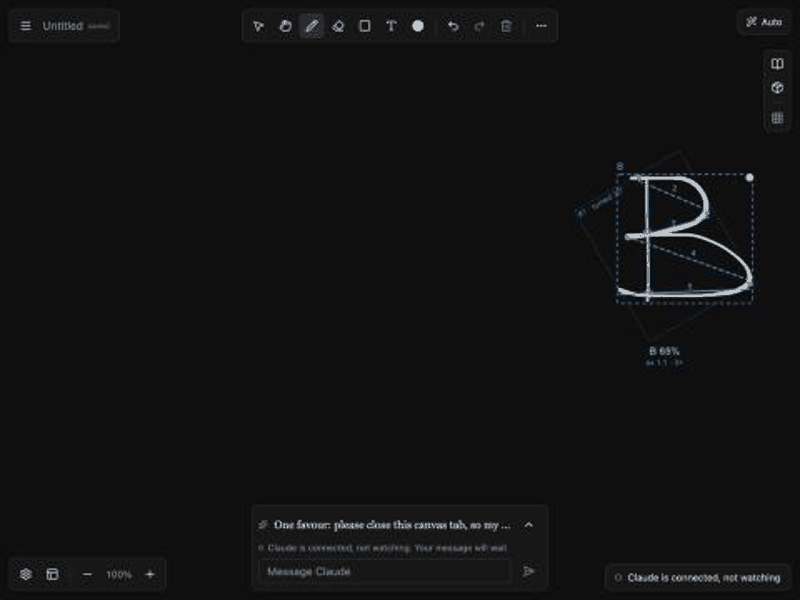
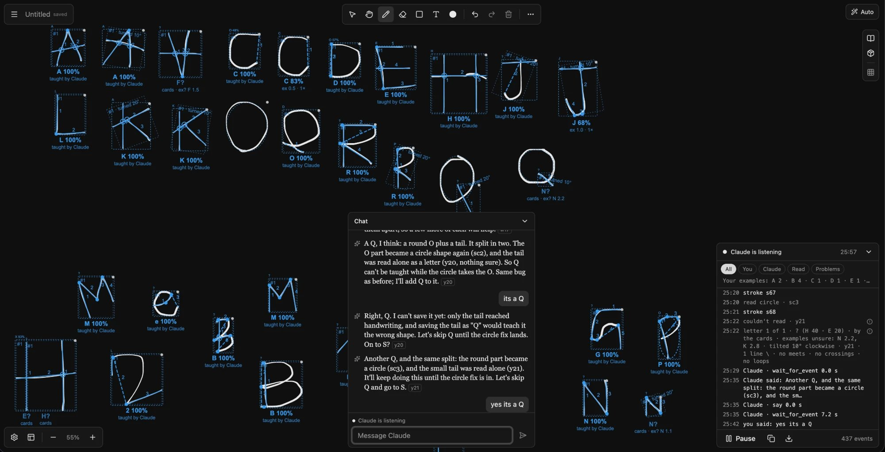
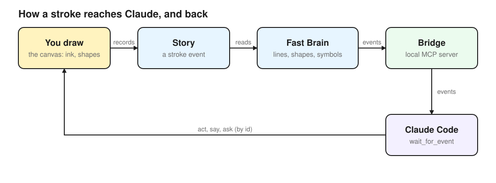

<div align="center">

# Visual Thinker

**Interact, play, learn and contribute.**

A shared canvas where Claude sees your drawing as data, not pixels.

[](https://github.com/heshamfd195/visual-thinker/actions/workflows/ci.yml)
[](LICENSE)



</div>

> 🚧 **Early days.** Visual Thinker is being built in the open toward its first release, `v0.1.0`. Every change you can see lands with a GIF in [docs/changes.md](docs/changes.md).

## What it is

You draw on a canvas, and every stroke reaches Claude as structured events instead of a screenshot: the ink, and what the canvas read from it (a line, a circle, an X). Claude answers on the same canvas, by object id, never by pixels.

## ✍️ Teach it your handwriting

Handwriting is the first **ability**: the canvas reads your letters, and you teach it the ones it doesn't know.

| step         | what happens                                                                                   |
| ------------ | ---------------------------------------------------------------------------------------------- |
| ✏️ you write | each letter's strokes are measured: its lines, curves, where they meet and cross, its loops    |
| 🔎 it reads  | your own saved examples first, then built-in character cards, then Claude when nothing is sure |
| 💬 you teach | say "it's t" in the chat; Claude labels the letter and it's saved as one of your examples      |
| 🔁 it learns | next time that letter is read alone, from your example, often from just one                    |

Your examples are kept with the ability, in [`abilities/handwriting/data/examples.json`](packages/core/src/abilities/handwriting/data/examples.json). The ability has its own [README](packages/core/src/abilities/handwriting/README.md).



Taught so far, in one sitting: all capitals but Q and the digits 0–9, 60 examples. Next: lowercase, then sentences, then Claude writing back through the same examples.

## Try it

The canvas runs on its own. You need Node 24 and pnpm.

```bash
pnpm install
pnpm dev
```

Then open the address it prints. Draw with the pen, place boxes, circles and arrows, select with the arrow, a box or a lasso, and resize or rotate with the handles.

## Use it with Claude Code

Once the `visthinker` package is on npm, adding it to Claude Code is one line:

```bash
claude mcp add visthinker -- npx visthinker
```

It isn't published yet. Until then, build it from this repo and point Claude Code at the built file:

```bash
pnpm install && pnpm build
```

```bash
claude mcp add visthinker -- node "$PWD/packages/visthinker/dist/visthinker.js"
```

Then ask Claude to open the canvas, draw something, and talk about it in the chat.

## How it works



| part           | what it does                                                                                  | status         |
| -------------- | --------------------------------------------------------------------------------------------- | -------------- |
| 🖼️ Canvas      | React + Konva in your browser: ink, shapes, select, transform, chat, events, projects         | ✅ first draft |
| 📜 Contract    | the shared shapes: events, scene objects, strokes, MCP tools, packs                           | ✅ working     |
| ⚡ Core        | pure TypeScript: the event story, the scene, undo, and the Fast Brain that reads your strokes | ✅ working     |
| 🔌 Bridge      | a local MCP server that connects the canvas to Claude Code                                    | ✅ working     |
| 📦 Packs       | knowledge as small data packs, not code changes                                               | ✅ working     |
| ✍️ Handwriting | an ability: you write, it reads, you teach it in the chat; Claude writing back is next        | ✅ first cut   |

More in [docs/architecture.md](docs/architecture.md).

## Layout

```
packages/contract   the shared shapes, as Zod schemas
packages/core       the Fast Brain: no React, no Konva, no Node
packages/bridge     the MCP server
packages/visthinker the npm package: the bridge bundled with the canvas and packs
apps/canvas         the React + Konva app
packs/              the starter packs: shapes, modes
docs/               how it's built, why, and where it's going
```

Imports go one way: the canvas uses the core, and the core uses only the contract. Lint enforces it.

## Docs

| file                                      | what's in it                           |
| ----------------------------------------- | -------------------------------------- |
| [architecture.md](docs/architecture.md)   | the packages, and how a stroke travels |
| [decisions.md](docs/decisions.md)         | the decisions that shape this repo     |
| [journey.md](docs/journey.md)             | how it got here                        |
| [design-system.md](docs/design-system.md) | how the whole app looks                |
| [user-stories.md](docs/user-stories.md)   | who it's for and what they can do      |
| [changes.md](docs/changes.md)             | every visible change, with its GIF     |
| [CLAUDE.md](CLAUDE.md)                    | how an agent works in this repo        |

## Open core

The app runs fully on your machine and is open source under the MIT licence. An optional hosted API can add packs later, and you can plug in your own.

## License

[MIT](LICENSE)
