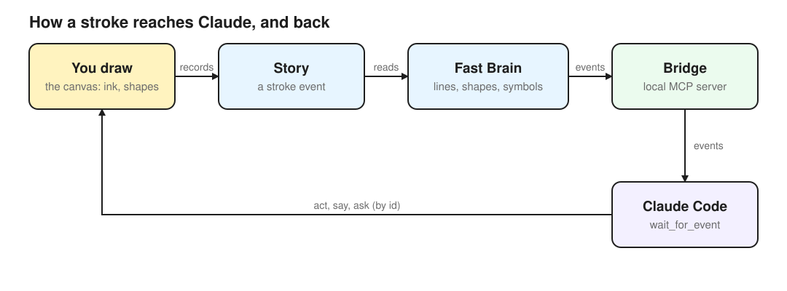

# 🏗️ Architecture

How Visual Thinker (code name `visthinker`) is put together: what lives where, how a stroke reaches Claude and back, and how it stays safe on your machine.



## 🗂️ What lives where

| part          | path                  | what it is                                                                                                                                   |
| ------------- | --------------------- | -------------------------------------------------------------------------------------------------------------------------------------------- |
| 📜 contract   | `packages/contract`   | the shared shapes as Zod schemas: events, scene objects, strokes, `act`, packs, projects, MCP tools, bridge messages                         |
| 🧠 core       | `packages/core`       | the Fast Brain, pure TypeScript: the story, scene store, history (undo), transform, comparator, abilities, packs loader, modes, tool handler |
| 🔌 bridge     | `packages/bridge`     | the MCP server over stdio, plus a localhost WebSocket and HTTP server for the canvas tab; saves projects and packs on disk                   |
| 📦 visthinker | `packages/visthinker` | the npm package: the bridge bundled with the built canvas and the starter packs                                                              |
| 🖼️ canvas     | `apps/canvas`         | the React 19 + Konva app in your browser; it runs the core                                                                                   |
| 🧩 packs      | `packs/`              | the starter packs, data only: `shapes` and `modes`                                                                                           |

### 🖼️ Inside the canvas

| folder      | what it holds                                                                                                                                              |
| ----------- | ---------------------------------------------------------------------------------------------------------------------------------------------------------- |
| `app/`      | `App.tsx` lays out the screen; `session.ts` picks an adapter for each core port and builds the canvas                                                      |
| `adapters/` | the real ports: system clock, WebSocket transport, React renderer, the bridge's HTTP API                                                                   |
| `features/` | one folder per feature: `ink`, `objects`, `transform`, `toolbar`, `guides`, `chat`, `events`, `library`, `packs`, `projects`, `settings`, `modes`, `shell` |
| `shared/`   | the theme and the shadcn/ui pieces in `shared/ui`                                                                                                          |

## ➡️ Imports go one way

```
canvas  →  core  →  contract
bridge  →  contract
visthinker (npm)  →  bridge
```

| from                           | may import                                                                  |
| ------------------------------ | --------------------------------------------------------------------------- |
| `contract`                     | nothing of ours                                                             |
| `core`                         | `contract`                                                                  |
| `bridge`                       | `contract`                                                                  |
| `visthinker`                   | `bridge`                                                                    |
| canvas `app/`                  | adapters, features, `shared/`, core, contract                               |
| canvas `features/*`            | other features **only through their `index.ts`**, `shared/`, core, contract |
| canvas `adapters/*`, `shared/` | `shared/`, core, contract                                                   |

- 🚦 `eslint-plugin-boundaries` enforces this in `eslint.config.js`. A wrong import fails `pnpm lint`.
- 🔌 The core never touches the DOM, Node or React. It talks to the outside through small **ports** (`Clock`, `Renderer`, `Transport`, `PackSource`), each with an in-memory fake for tests.

## 🔁 The loop: a stroke to Claude and back

| #   | step                                                                                                                                                                                                                        | where                                       |
| --- | --------------------------------------------------------------------------------------------------------------------------------------------------------------------------------------------------------------------------- | ------------------------------------------- |
| 1   | ✏️ Your pointer draws. The live line is drawn straight on Konva so it doesn't re-render per point.                                                                                                                          | `features/ink`                              |
| 2   | 📥 The finished stroke is kept raw, never smoothed: points as `[x, y, pressure, dt]`.                                                                                                                                       | contract `Stroke`                           |
| 3   | 📜 It goes into the **story** as a `stroke` event (its box and point count, no points).                                                                                                                                     | core `scene/story.ts`                       |
| 4   | 🧠 The **comparator** (Fast Brain) reads it: a long straight stroke is a line at once, two lines that cross make a crossing; other strokes are grouped and read about 0.6 s later as a box, circle, arrow or symbol (X, O). | core `comparator/`                          |
| 5   | 🏷️ Each thing it reads becomes a scene object and a `recognized` event whose `cause` is the stroke.                                                                                                                         | core `scene/store.ts`                       |
| 6   | 🔌 Claude calls `wait_for_event` (or `get_events`). The bridge passes the call over the WebSocket; the canvas answers with every unread event.                                                                              | bridge → canvas                             |
| 7   | 🔍 For more, Claude calls `get_scene` (objects and relations) or `get_strokes` (raw points of one object).                                                                                                                  | core `tools/handler.ts`                     |
| 8   | 🤝 Claude acts **by id, never by pixels**: `act` (add, move, label, remove), `say`, `ask`, `set_mode`.                                                                                                                      | core `tools/act.ts`                         |
| 9   | 🖼️ Each answer is new events in the story; the canvas redraws from them.                                                                                                                                                    | `app/`, `features/objects`, `features/chat` |

- 🧭 The **browser owns the state**. The bridge keeps none: it relays `{ id, call, args }` and the answer `{ id, ok, result }` or `{ id, ok: false, error }`.
- 🙋 Only Claude starts a call. The canvas never pushes.
- ✋ Moving or removing **your own drawing** is not done straight away: it becomes a proposal you apply or dismiss in the chat.
- 💬 `ask` gets its answer later, as an `answer` event whose `cause` is the ask.
- 📚 The bridge answers `open_canvas`, `list_packs`, `install_pack` and `read_pack` itself. `write_pack` is saved on disk first, then loaded by the canvas.

## 📜 The story, the scene and the history

| piece      | what it is                                                                                                                                                                                     |
| ---------- | ---------------------------------------------------------------------------------------------------------------------------------------------------------------------------------------------- |
| 📜 story   | an **append-only** list of events: `seq`, `t`, `who` (user, fastbrain, claude, api), `type`, `target`, `detail`, `cause`. Nothing is ever deleted. A read cursor gives Claude only what's new. |
| 🧱 scene   | what is on the canvas now: objects with stable ids that are never reused, each with its `kind`, `label`, `box`, `relations`, `parts`, and the strokes that made it                             |
| ↩️ history | keeps the scene and the visible ink in step with undo, redo, clear, the eraser and transforms                                                                                                  |

- ↩️ **Undo is an event.** It points at what it takes back; `redo` points at the undo it cancels.
- 🙋 Undo takes back only **your** actions (strokes, places, moves, transforms, clear, erase).
- 🧹 `clear` is one event that hides everything; one undo brings it all back.
- 🔄 A resize, rotate or move with the handles is one `transform` event, so undo restores the exact shape.

## 💾 Projects on disk

| what                                                          | where                                                                                       |
| ------------------------------------------------------------- | ------------------------------------------------------------------------------------------- |
| 🗂️ a project: one canvas, many chats                          | `~/.visthinker/projects/<id>/project.json`                                                  |
| 📸 inside it                                                  | its story, ink, scene objects (with who made them), undo history, chats and a small picture |
| ⚙️ how things behave (ask Claude when unsure, saving stories) | `~/.visthinker/settings.json`                                                               |
| 🎨 how things look (theme, canvas colour, panels)             | this browser only                                                                           |
| 📦 your own packs                                             | `~/.visthinker/packs/<name>/`                                                               |

- 💾 The canvas saves a moment after each change, through the bridge's HTTP API. Files are checked against the contract and written to a temp file first.
- 🧪 Opened without the bridge (`pnpm dev`), the project lives only in that tab. You can still export it to a file and open it again.
- 🏠 `VISTHINKER_HOME` moves the folder (tests use a temp dir).

## 🔒 Security in short

| rule                   | how                                                                                                     |
| ---------------------- | ------------------------------------------------------------------------------------------------------- |
| 🏠 localhost only      | the bridge listens on `127.0.0.1`, never `0.0.0.0`                                                      |
| 🔑 a token per session | a fresh random token goes in the `open_canvas` link; no token, no connection. It dies with the session. |
| 🌐 Origin check        | only the bridge's own page may connect; other websites get a bare 403                                   |
| 🏷️ Host check          | only `127.0.0.1` and `localhost` on the bridge's port, so DNS rebinding is refused                      |
| 🪟 one tab             | one canvas tab per session; a second one is turned away                                                 |
| 📜 contract check      | the tab says its contract version first; every call's args and result are checked with Zod              |

The HTTP API follows the same rules, with the token as a `Bearer` header. More in [SECURITY.md](../SECURITY.md).

## 🧱 The four layers

| layer             | what it is                                                                                                  | here today                                                                                                                                                                                                                                                                                                                                                                                                                                                                                                                                                                                                                                                                                                                                                                                                |
| ----------------- | ----------------------------------------------------------------------------------------------------------- | --------------------------------------------------------------------------------------------------------------------------------------------------------------------------------------------------------------------------------------------------------------------------------------------------------------------------------------------------------------------------------------------------------------------------------------------------------------------------------------------------------------------------------------------------------------------------------------------------------------------------------------------------------------------------------------------------------------------------------------------------------------------------------------------------------- |
| 🗂️ project        | what you're doing: one canvas with many chats                                                               | ✅ saved on disk, reopened, many chats · 💭 planned: **the project decides which knowledge runs**. Today the starter packs load for every project.                                                                                                                                                                                                                                                                                                                                                                                                                                                                                                                                                                                                                                                        |
| 📦 knowledge pack | rules and facts as data: `pack.json`, `rules.json`, `README.md`, checked before anything is read            | ✅ `shapes` (lines, crossings, X and O templates) and `modes` (Claude's card for each mode) · your own packs on disk · Claude can write one with `write_pack` · switch a pack off in the packs panel                                                                                                                                                                                                                                                                                                                                                                                                                                                                                                                                                                                                      |
| 📚 library        | things you put on the canvas                                                                                | ✅ artifacts (box, circle, arrow), symbols, and drawings you saved ("Yours", kept in this browser)                                                                                                                                                                                                                                                                                                                                                                                                                                                                                                                                                                                                                                                                                                        |
| ✋ abilities      | how the canvas reads your input, e.g. handwriting, smart selection; on by default, each can be switched off | 🚧 handwriting, started (T51): `core/abilities/handwriting` splits each group into letters and measures each (lines, meets, crossings, loops). Each letter is read by the character cards (A, H, E, L, O so far): clear at 70 or more with a lead of 15, else `?`; each part a card can't explain costs 20. A tilted letter (up to 30°) is read turned upright. A letter you're still writing waits (`…`) for its name until you pause or move on. Two or more letters, or one clear letter, are a `word` such as `HELLO` (no X or O guess); its `recognized` event lists its letters and its text, and each new or changed letter gets a `letter` event with its name and score. Not yet: the other letters, and Claude for the unsure ones. Switch on or off what it measured in Settings → Appearance. |

- 🧩 A pack wires **building blocks** the core ships (`line`, `crossing`, `symbol`, `modes`). A block the core doesn't know loads and does nothing.
- ☁️ An optional hosted pack API can add packs later.

## 🛠️ Run it

| command      | does                                                                  |
| ------------ | --------------------------------------------------------------------- |
| `pnpm dev`   | the canvas on its own, no Claude                                      |
| `pnpm build` | builds everything, including `packages/visthinker/dist/visthinker.js` |
| `pnpm check` | typecheck, lint, format, tests, build                                 |
