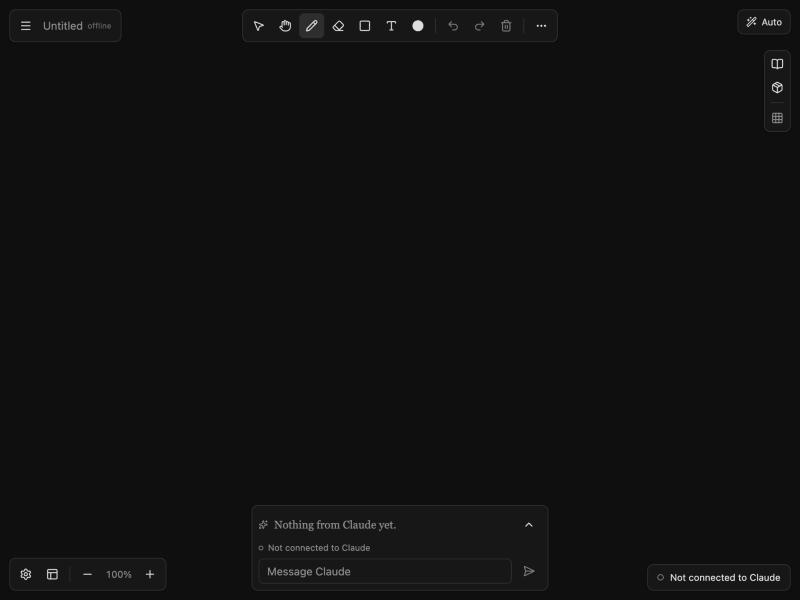

# 🎞️ Changes you can see

Every pull request that changes what you see on the canvas adds a short GIF here, newest first, and the newest one also leads the [README](../README.md) (D164). GIFs live in [`images/changes/`](images/changes/), named `YYYY-MM-DD-what.gif`, each under about 3 MB.

## 2026-11-24 · Select, transform and guides

PRs [#84](https://github.com/heshamfd195/visual-thinker/pull/84) and [#99](https://github.com/heshamfd195/visual-thinker/pull/99): the first full interface, then the fixes from its first real run.

- ✏️ An X is read at 100%, a circle as a circle.
- 🔲 Select by arrow, box or lasso, with a marching dashed outline (D154).
- 🔄 Handles to resize, rotate (snaps every 45°) and move, as one undoable event (D157).
- 🗑️ Delete from the toolbar or the keyboard (D155); one guide at a time (D156).
- 🧹 Tic-tac-toe is out for now, to come back rebuilt around projects (D162).

## Before the GIFs

The work up to the first interface had no GIFs. It's told in [journey.md](journey.md), with links to each pull request.
