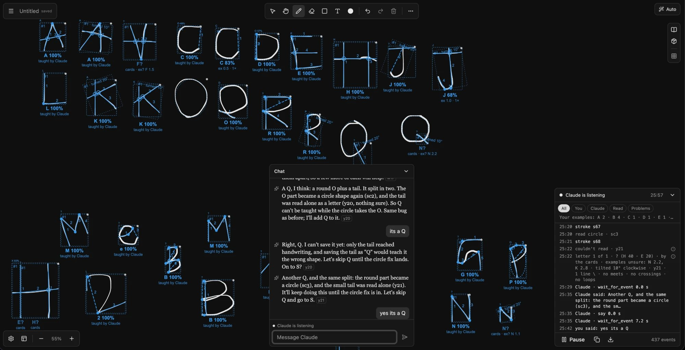

# 🧭 Journey

How Visual Thinker got to where it is, for anyone reading the repo for the first time.
Decision numbers (D-numbers) point to [decisions.md](decisions.md).

## 🎯 The idea

Showing an AI a drawing usually means sending a screenshot.
Visual Thinker is a shared canvas where every stroke, shape and tap reaches Claude as data: an ordered story of events and a scene it can read ([D01](decisions.md#-what-it-is), [D76](decisions.md#-contract)).
Claude answers on the same canvas. Drawing is the heart of it ([D46](decisions.md#-what-it-is)).

## 🧪 The dry run

Before this repo existed, a throwaway prototype proved the loop. It lived in a local folder and was never pushed ([D94](decisions.md#-tooling--workflow)).

| step              | what happened                                                                                                                                      |
| ----------------- | -------------------------------------------------------------------------------------------------------------------------------------------------- |
| 📜 contract first | the event, stroke, scene and tool shapes were written down first, so the canvas, the core and the bridge could be built in parallel                |
| 🔗 the join       | four hand-drawn lines became 4 lines and 4 crossings, Claude answered through MCP, and its O landed in the right cell, with no screenshot anywhere |
| 🏁 full games     | a win, a draw and a rematch, with drawn X moves on tilted grids                                                                                    |

What it taught:

| finding                                                    | what changed                                                                      |
| ---------------------------------------------------------- | --------------------------------------------------------------------------------- |
| ✂️ an X was read as two lines and a crossing               | group strokes into one symbol first ([D96](decisions.md#-fast-brain--comparator)) |
| 📏 at 160 units, a letter's strokes turned into lines      | lines start at 400 units for now ([D109](decisions.md#-fast-brain--comparator))   |
| ⏱️ each tool call waited on Claude Code's permission check | pre-approving the tools took a call's round trip from 0.6 s to 14 ms              |

Then the real foundation started here, public from the first commit ([D85](decisions.md#-tooling--workflow)).

## 🏗️ Weeks 1–3: the foundation

| week                               | what was built                                                                                                                                                                                                                                                                                                                                  | PRs     |
| ---------------------------------- | ----------------------------------------------------------------------------------------------------------------------------------------------------------------------------------------------------------------------------------------------------------------------------------------------------------------------------------------------- | ------- |
| 🏗️ 1 · a canvas that remembers     | the workspace, lint and CI · the contract as Zod schemas · an append-only event story with undo as an event ([D78](decisions.md#-undo--history)) · a Konva canvas with ink, shapes, a toolbar and a live story panel · the README                                                                                                               | #4–#28  |
| 🔌 2 · the bridge                  | an MCP server over stdio · a session with a token, localhost only, an Origin check and one tab ([D82](decisions.md#-bridge--security)) · `open_canvas` and a WebSocket to the canvas · `get_events`, `wait_for_event`, `act`, `say`, `ask` · packs loaded from data · tic-tac-toe as the first end-to-end game (#50) · the `visthinker` package | #30–#52 |
| 🧭 3 · it understands your drawing | the comparator: a shape alphabet, the `$P` recognizer, grouping strokes · "Tic-tac-toe?" when a drawing matches · a drawn X plays a move · relations in `get_scene` · list, read and install packs                                                                                                                                              | #54–#66 |

Two more before the UI:

| PR  | what                                                                                                                          |
| --- | ----------------------------------------------------------------------------------------------------------------------------- |
| #67 | ⏱️ a late stroke rejoins the last symbol, so a slow X is still one X ([D110](decisions.md#-fast-brain--comparator))           |
| #69 | 🧩 shadcn/ui, Tailwind and Lucide with a greyscale theme ([D140](decisions.md#-canvas--ui), [D145](decisions.md#-canvas--ui)) |

## 🖼️ The first full UI (PR #84)

The whole interface landed in one PR, a commit per task ([D147](decisions.md#-tooling--workflow)): the layout in three states, the toolbar, undo, redo and clear, projects saved on disk, the chat, the events box, the library, packs, settings and modes ([D119](decisions.md#-canvas--ui)–[D146](decisions.md#-canvas--ui)).

Using it for real turned up these:

| found                                                                                                          | what changed                                                                                                                                                                                                                                    |
| -------------------------------------------------------------------------------------------------------------- | ----------------------------------------------------------------------------------------------------------------------------------------------------------------------------------------------------------------------------------------------- |
| 🐞 nothing could be drawn: the canvas reloaded the latest project about 50 times a second, wiping every stroke | projects load once, above the canvas                                                                                                                                                                                                            |
| 🔲 one select tool did box and lasso at once, which was confusing                                              | Arrow, Box select and Lasso select under one button ([D154](decisions.md#-canvas--ui))                                                                                                                                                          |
| 🗑️ there was no way to delete                                                                                  | a trash button and the Delete key ([D155](decisions.md#-canvas--ui))                                                                                                                                                                            |
| 📐 dots, grid and lines could all show at once                                                                 | one guide at a time, with three opacities ([D156](decisions.md#-canvas--ui))                                                                                                                                                                    |
| 🔄 shapes couldn't be resized or rotated                                                                       | handles on the selection, one undoable `transform` event ([D157](decisions.md#-canvas--ui))                                                                                                                                                     |
| 💬 "Claude is away" was unclear                                                                                | "Claude is connected, not watching" or "Not connected to Claude" ([D158](decisions.md#-canvas--ui))                                                                                                                                             |
| 👂 Claude reacted to chat but not to drawing                                                                   | giving the canvas its own Claude was considered and dropped, to stay inside Claude Code ([D150](decisions.md#-what-it-is)); the planned fix, not built yet, is built-in instructions in the MCP server ([D151](decisions.md#-bridge--security)) |

The UI is a first draft ([D159](decisions.md#-canvas--ui)).

## 🧹 The pivot

Tic-tac-toe proved the loop, but it had started to shape the whole app. So it left for now (PR #99, [D162](decisions.md#-what-it-is)), to come back later as a project.

What stayed: the four modes, the pack format, the `$P` reader, and the reading of lines, crossings and shapes.

The app now has four layers, kept apart ([D160](decisions.md#-what-it-is)):

| layer             | what it is                                                          | example                      |
| ----------------- | ------------------------------------------------------------------- | ---------------------------- |
| 🗂️ project        | what you're doing; it decides which knowledge is in play            | "learning chess"             |
| 📦 knowledge pack | rules and facts; one project can use several                        | the `shapes` pack            |
| 📚 library        | things you put on the canvas                                        | symbols like π and √         |
| ✋ ability        | how the canvas reads your input; on by default, can be switched off | handwriting, smart selection |

Handwriting is the next ability ([D161](decisions.md#-what-it-is)), and it works two ways:

| way                        | how                                                                                                                                                                                                                        |
| -------------------------- | -------------------------------------------------------------------------------------------------------------------------------------------------------------------------------------------------------------------------- |
| ✍️ you write, Claude reads | the Fast Brain reads clear letters by their structure, and hands unsure ones to Claude with its best guesses ([D111](decisions.md#-handwriting-ability-being-built)–[D118](decisions.md#-handwriting-ability-being-built)) |
| 🖊️ Claude writes back      | so written words and some maths can go both ways; how it looks is still being designed                                                                                                                                     |

## ✍️ Teaching it your handwriting (PR #103)

The first cut read letters only by built-in character cards. Real handwriting broke it often: a slow H split in two, a round O became a circle, an F was read as P.

So the ability learns from you instead ([D174](decisions.md#-handwriting-ability-being-built)–[D183](decisions.md#-handwriting-ability-being-built)):

| step                 | what changed                                                                                                                    |
| -------------------- | ------------------------------------------------------------------------------------------------------------------------------- |
| 💬 teach in the chat | you say "it's K", Claude labels the letter, and its raw strokes are saved as your example                                       |
| 🔎 examples first    | a letter is named by your nearest example when one is sure, then by the cards, then by Claude                                   |
| 📁 in the repo       | the examples live with the ability, so teaching is a change in git                                                              |
| 🧪 tested live       | one sitting taught all capitals but Q and the digits 0–9: 60 examples. Most letters were read alone after one to three examples |

What the live test turned up, and fixed: a tilt guess no longer decides a letter (D180), "sure" needs a closer match (D181), a mark can be "not a letter" (D182), and a Q's tail joins its circle (D183).

## 🔜 What's next

- ✍️ Lowercase, then sentences with basic punctuation; then Claude writes back by replaying your examples through the Fast Brain (D171, D172).
- 🧹 UI polish and bugs from the first draft (issues #85–#97).
- 🚀 Later: end-to-end tests and the first release, `v0.1.0`.
